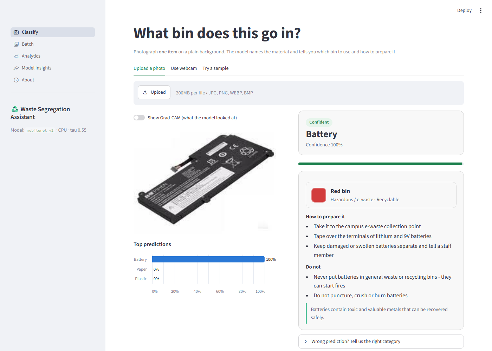
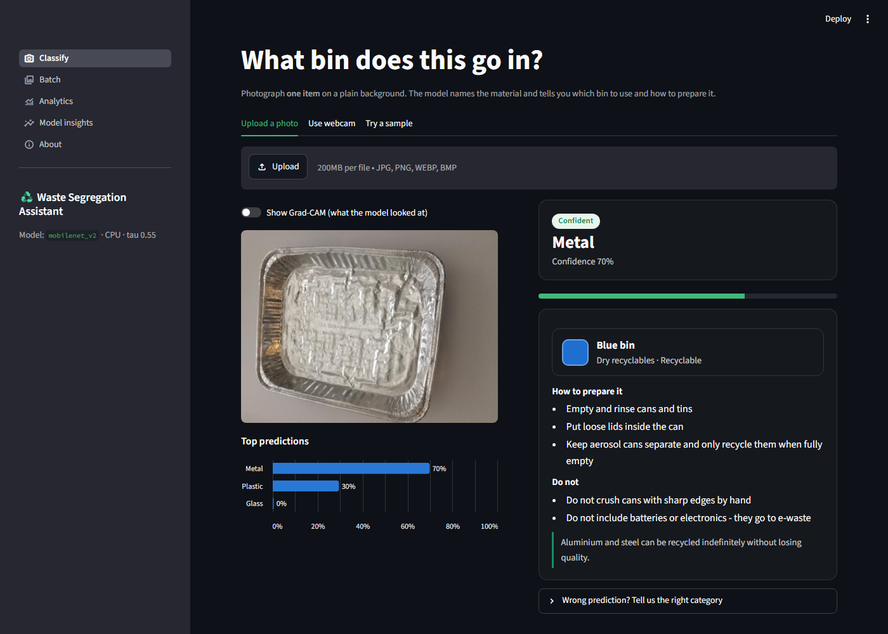
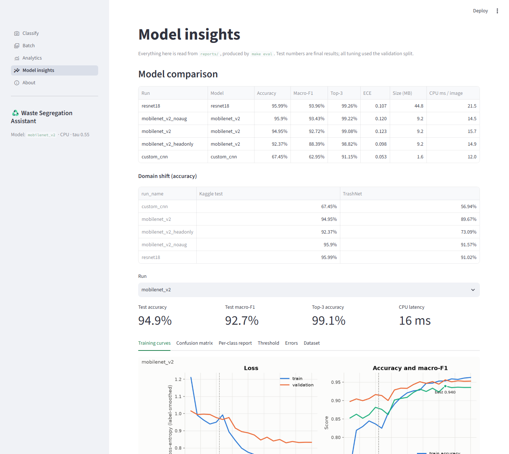

# Campus Waste Segregation Assistant

Photograph a waste item, and the app tells you **what it is**, **which bin it goes in** and
**how to prepare it**. A CNN classifies the item into one of nine categories. A disposal
engine then turns that label into an action: the bin colour, preparation steps, a do-not list,
and a safe fallback when the model is unsure.

*Neural Network & Deep Learning (PCCCS582) - End-term Project #5. The full design is in [PLAN.md](PLAN.md).*

| | |
|---|---|
| Classes | paper, cardboard, plastic, metal, glass, organic, battery, textile, general |
| Primary model | MobileNetV2 (ImageNet weights), two-phase fine-tuning |
| Baseline | 4-block CNN trained from scratch |
| Novelty | Config-driven disposal recommendations with confidence-aware fallback, Grad-CAM, analytics dashboard, user feedback loop |
| App | Streamlit: upload or webcam, batch/ZIP mode, analytics, model insights. Runs on CPU |

## Quick start (demo in two commands)

If a trained checkpoint is already in `models/mobilenet_v2/best.pt`:

```bash
pip install -r requirements.txt && pip install -e .
streamlit run app/streamlit_app.py
```

## Full setup

Python 3.10 or newer. On Windows, use `./tasks.ps1 <target>` wherever this README says
`make <target>`.

```bash
python -m venv .venv
# Windows: .venv\Scripts\activate     Linux/macOS: source .venv/bin/activate

# PyTorch first, for your hardware (NVIDIA GPU shown; CPU-only can skip this line)
pip install torch torchvision --index-url https://download.pytorch.org/whl/cu126
make setup            # installs requirements.txt and the package in editable mode
```

### Dataset download

`make data` downloads the public Kaggle dataset with the Kaggle CLI (anonymous download worked
with `kaggle` 2.2). If your Kaggle client asks you to sign in, run `kaggle auth login` or create
a token at kaggle.com -> Settings -> API. If the download still fails, the script prints manual
download steps. `python scripts/download_data.py --trashnet` also fetches TrashNet for the
domain-shift test.

## Commands

| Command | What it does |
|---|---|
| `make data` | Download, resize, de-duplicate (pHash), stratified 70/15/15 split -> `data/splits/manifest.csv`, EDA -> `reports/eda/` |
| `make train-baseline` | Train the custom CNN -> `models/custom_cnn/best.pt`, `reports/custom_cnn/` |
| `make train` | Train MobileNetV2 (head, then fine-tune) -> `models/mobilenet_v2/best.pt` |
| `make ablations` | No-augmentation, head-only and ResNet18 runs |
| `make eval` | Test metrics for every run, threshold tuning on validation, `reports/comparison.md` |
| `make robustness` | TrashNet and campus-set evaluation (domain shift) |
| `make app` | Start the Streamlit app |
| `make test` / `make lint` | pytest / ruff |
| `make export` / `make benchmark` | ONNX export and CPU latency benchmark |
| `python scripts/train_yolo.py` | Optional YOLOv8n-cls comparison (needs `pip install ultralytics`) |

The Classify page also has a **Try a sample** tab: it lists the photos in `app/samples/` plus
one held-out test image per class. `http://localhost:8501/?sample=<name>` preselects one,
which is handy for a live demo.

Single-image prediction from the command line:

```bash
python -m waste.predict path/to/photo.jpg
```

## Results

All numbers come from `reports/comparison.md` and `reports/benchmark.md` (RTX 4050 laptop GPU
for training, CPU for inference, seed 42). Model selection and the threshold used validation
only. Test, TrashNet and campus numbers are final reports.

| Model | Kaggle test acc. | Test macro-F1 | TrashNet acc. | Size | CPU latency (PyTorch) |
|---|---|---|---|---|---|
| Custom CNN (baseline) | 67.5% | 62.9% | 56.9% | 1.6 MB | 11 ms |
| MobileNetV2, head only | 92.4% | 88.4% | 73.1% | 9.2 MB | 15 ms |
| **MobileNetV2, fine-tuned (app model)** | **94.9%** | **92.7%** | **89.7%** | **9.2 MB** | **16 ms** (2.5 ms in ONNX Runtime) |
| MobileNetV2, fine-tuned, no augmentation | 95.9% | 93.4% | 91.6% | 9.2 MB | 15 ms |
| ResNet18, fine-tuned | 96.0% | 94.0% | 91.0% | 44.8 MB | 22 ms |

- **Targets met:** MobileNetV2 test accuracy is 94.9% (target 90%), and the lowest class F1 is
  plastic at 0.83 (target 0.80).
- **Transfer learning:** +29.8 macro-F1 points over the from-scratch CNN. **Fine-tuning:** +4.3
  points over head-only training.
- **Augmentation did not help on this data:** -0.7 points on the Kaggle test split and -1.9
  accuracy points on TrashNet. Both test sets are clean, centred product-style photos; whether
  augmentation helps on messier campus photos is still to be measured.
- **Threshold:** temperature scaling (T = 0.50) cut calibration error from 0.132 to 0.008. Then
  tau = 0.55 answers 97.5% of validation images confidently at 97.0% accuracy.
- **Domain shift:** on TrashNet, five of the six classes score F1 0.89-0.96, but *general* scores
  0. TrashNet's "trash" folder is mostly plastic pouches, foil and tissue, which the model
  labels by material. See `reports/mobilenet_v2/eval_trashnet/error_gallery.png`.
- **Most common confusion:** glass predicted as plastic (clear bottles), as the plan expected.

| Recommendation (confident) | Uncertain state (dark theme) | Model insights |
|---|---|---|
|  |  |  |

## How it works

```
photo -> resize 256, centre crop 224, normalise -> CNN -> softmax (temperature-scaled)
      -> confidence state -> disposal engine (configs/disposal_map.json) -> recommendation card
```

| State | Rule | What the user sees |
|---|---|---|
| Confident | top probability >= tau | Class, confidence, bin badge, preparation steps, do-not list |
| Uncertain | reject <= p < tau | Top-2 candidates and "when in doubt, keep it out of recycling and ask a staff member" |
| Unrecognised | p < reject | Retake-photo guidance |

`tau` is tuned on the validation set with an accuracy-vs-coverage curve
(`python -m waste.evaluate coverage --run mobilenet_v2 --write-config`). Bins, colours and
wording are edited in `configs/disposal_map.json` and validated at startup.

### Campus test set

Put 15-20 phone photos per class in `data/campus_test/<class>/` (class names as above) and run
`make robustness`. These photos are used for final testing only, never for training or tuning.

## Repository layout

```
configs/      data, class map, training runs, inference thresholds, disposal map
src/waste/    data/ (prepare, dedupe, split, dataset, transforms), models/, train, evaluate,
              predict, disposal, explain (Grad-CAM), logstore (SQLite), checkpoint, plotting
app/          streamlit_app.py + pages/ (classify, batch, analytics, insights, about)
scripts/      download_data.py, export_onnx.py, benchmark.py
tests/        pytest suite (runs without the dataset)
reports/      metrics, figures, EDA, comparison tables (generated)
```

## Limitations

- One item per photo; there is no multi-object detection.
- Training images are clean studio-style shots, so accuracy on messy real-world photos is lower.
  The campus set measures this gap.
- Mixed-material items have no single right answer. The uncertain state and the safe-default
  rule handle them.
